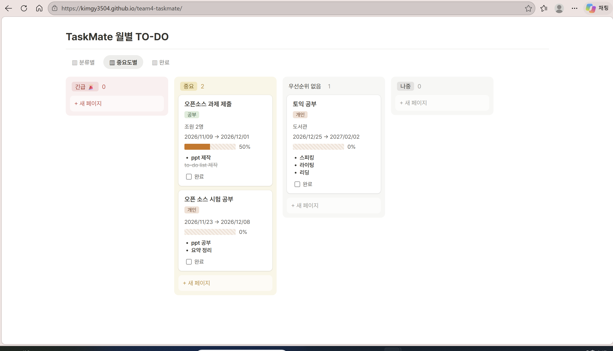

# TaskMate

개발 상태: 기능 구현 완료함

## 프로젝트 소개
할 일을 노션 보드처럼 칸(긴급·중요·우선순위 없음·나중)에 나눠 보고, 세부 할 일로 진행률을 관리하는 웹 애플리케이션입니다.
2명이 GitHub의 Issue → Branch → Pull Request → Review → Merge 흐름으로 함께 개발했습니다.

## 주요 기능
- 할 일 추가 / 수정 / 삭제 / 완료 체크 (칸마다 「+ 새 페이지」)
- 보기 탭: 중요도별(긴급·중요·우선순위 없음·나중) / 분류별(공부·개인·가족·기타) / 완료
- 카드에 분류 태그, 메모, 날짜(시작 → 마감), 기한 지남 표시
- 세부 할 일 체크리스트와 진행률 막대(퍼센트)
- LocalStorage 저장: 새로고침해도 목록 유지

## 실행 화면

## 실행 방법
- 배포 주소: https://<팀장아이디>.github.io/<저장소이름>/
- 또는 저장소를 내려받아 index.html을 브라우저로 열기

## 사용한 기술과 오픈소스
- HTML, CSS, JavaScript, LocalStorage, Git, GitHub, VS Code
- 외부 라이브러리 없이 작성 

## 팀원 및 역할
| 이름 | 역할 | 담당 파일 |
|---|---|---|
| 김가령 | 데이터·핵심 기능 | js/taskService.js, js/storage.js |
| (팀원 B 이름) | 화면·사용자 기능 | index.html, css/style.css, js/ui.js, js/filters.js, js/progress.js |
